# FinPay — Financial Transaction System

A RESTful financial transaction management system built with Java and Spring Boot, featuring payment processing through Stripe, PostgreSQL persistence, API authentication, and Docker containerization.

## Overview

FinPay is a backend application designed to manage financial transactions and integrate secure payment processing workflows using Stripe.

The system supports transaction creation, retrieval, filtering, pagination, sorting, input validation, and payment status updates through Stripe webhooks.

## Features

- Create and retrieve financial transactions.
- List transactions with pagination and sorting.
- Filter transactions by status.
- Validate transaction amounts and currency codes.
- Centralized exception handling and HTTP error responses.
- Integrate with Stripe PaymentIntents.
- Process Stripe webhooks for successful and failed payments.
- Track transaction statuses: `PENDING`, `COMPLETED`, `FAILED`, and `CANCELLED`.
- Protect API endpoints with HTTP Basic Authentication.
- Persist data using PostgreSQL.
- Manage database schema changes with Flyway.
- Run the application and database using Docker Compose.
- Unit tests with JUnit and Mockito.

## Tech Stack

| Technology | Purpose |
|---|---|
| Java 21 | Programming language |
| Spring Boot 4.1.2 | Backend framework |
| Spring Data JPA | Data persistence |
| Spring Security | API authentication |
| PostgreSQL 16 | Relational database |
| Flyway | Database migrations |
| Stripe Java SDK | Payment integration |
| Maven | Dependency and build management |
| JUnit and Mockito | Testing |
| Docker and Docker Compose | Containerization |
| Postman | API testing |

## Architecture

The application follows a layered architecture:

- **Controller:** Handles HTTP requests and responses.
- **Service:** Implements business logic.
- **Repository:** Handles database operations.
- **Entity:** Represents persistent transaction data.
- **DTO:** Defines API request and response structures.
- **Integration:** Handles communication with Stripe.
- **Config:** Contains application and security configuration.
- **Exception:** Handles application errors.

## Transaction Status Flow

- `PENDING`: Transaction created and awaiting payment.
- `COMPLETED`: Payment successfully confirmed.
- `FAILED`: Payment failed.
- `CANCELLED`: Transaction cancelled.

Stripe webhooks are used to synchronize payment events with transaction statuses.

## API Endpoints

Base URL: `http://localhost:8080`

| Method | Endpoint | Description |
|---|---|---|
| POST | `/api/transactions` | Create a transaction |
| GET | `/api/transactions` | List transactions |
| GET | `/api/transactions/{id}` | Retrieve a transaction |
| POST | `/api/transactions/{id}/payment` | Create a Stripe PaymentIntent |
| POST | `/api/stripe/webhook` | Receive Stripe payment events |
| GET | `/actuator/health` | Check application health |

### Transaction Listing

The listing endpoint supports filtering, pagination, and sorting.

Examples:

```http
GET /api/transactions?status=PENDING
GET /api/transactions?page=0&size=5
GET /api/transactions?sortBy=amount&direction=asc
```

### Authentication

The transaction endpoints use HTTP Basic Authentication.

The application health endpoint is publicly accessible. The Stripe webhook endpoint is also publicly reachable, but Stripe event signatures are verified by the application.

## Getting Started

### Prerequisites

- Java 21
- Maven
- Docker Desktop
- A Stripe account with test-mode credentials
- Stripe CLI

### Environment Variables

Create a `.env` file in the project root directory.

Use the following structure:

```properties
FINPAY_API_USER=your_api_username
FINPAY_API_PASSWORD=your_secure_password
STRIPE_SECRET_KEY=sk_test_your_stripe_secret_key
STRIPE_WEBHOOK_SECRET=whsec_your_webhook_signing_secret
```

Replace the placeholder values with your own credentials.

**Never commit your `.env` file or publish secret keys to GitHub.**

### Build the Application

Run:

```bash
mvn clean package
```

### Run with Docker Compose

Build and start the application and PostgreSQL database:

```bash
docker compose up --build -d
```

Check container status:

```bash
docker compose ps
```

Check application logs:

```bash
docker compose logs -f app
```

The application will be available at:

```text
http://localhost:8080
```

### Health Check

```http
GET http://localhost:8080/actuator/health
```

Expected response:

```json
{
  "status": "UP"
}
```

## Stripe Integration

FinPay integrates with Stripe in test mode using PaymentIntents.

To forward Stripe webhook events to the local application, run:

```bash
stripe listen --events payment_intent.succeeded,payment_intent.payment_failed --forward-to http://localhost:8080/api/stripe/webhook
```

Configure the generated webhook signing secret as `STRIPE_WEBHOOK_SECRET`.

The application handles:

- `payment_intent.succeeded`
- `payment_intent.payment_failed`

The webhook updates the corresponding transaction status in PostgreSQL.

## Testing

Run the automated tests with:

```bash
mvn test
```

The project includes unit tests for transaction creation, retrieval, listing, and status filtering.

API behavior and payment workflows were also manually validated using Postman and Stripe test mode.

## Database

PostgreSQL stores transaction records, including:

- Transaction ID
- Amount
- Currency
- Status
- Payment reference
- Creation timestamp

Flyway manages the database schema through versioned SQL migrations.

## Future Improvements

- JWT-based authentication and authorization.
- Integration and end-to-end test coverage.
- Additional payment methods.
- Enhanced transaction reporting and monitoring.

## Author

Developed as a backend portfolio project to demonstrate Java, Spring Boot, REST API development, database integration, payment processing, automated testing, and containerization.


---

## Screenshots & Evidence

The following screenshots demonstrate the main features and functional validation of FinPay.

### 1. Transaction Management

**Transaction creation — HTTP 201**

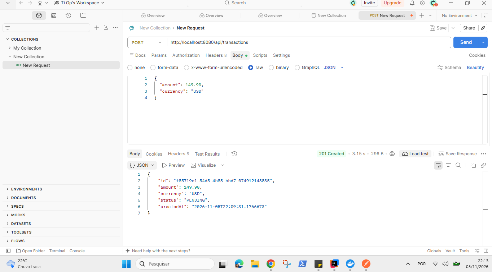

**Transaction retrieval**

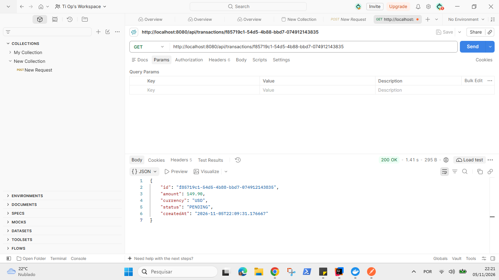

**Input validation — HTTP 400**

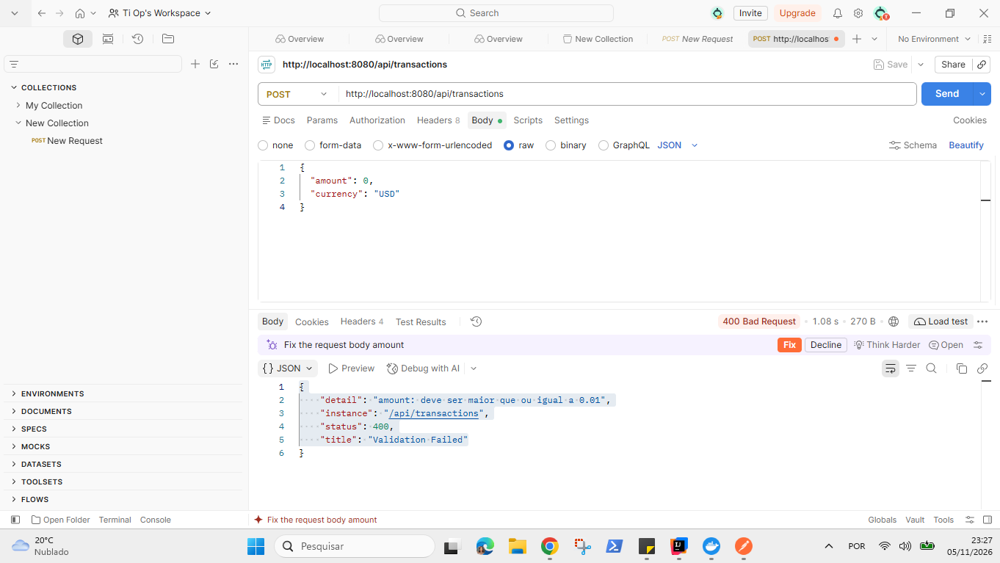

**Invalid JSON**

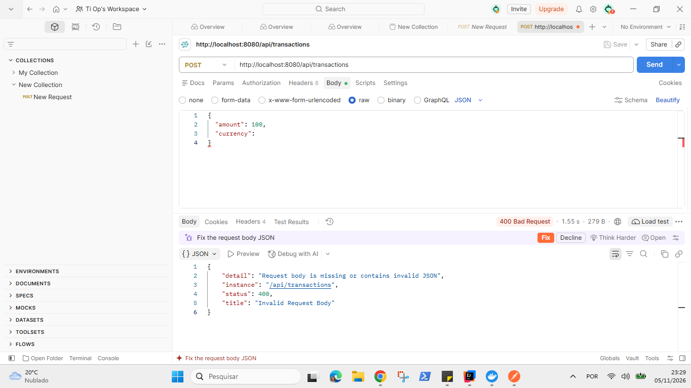

**Invalid currency**


**Invalid decimal precision**

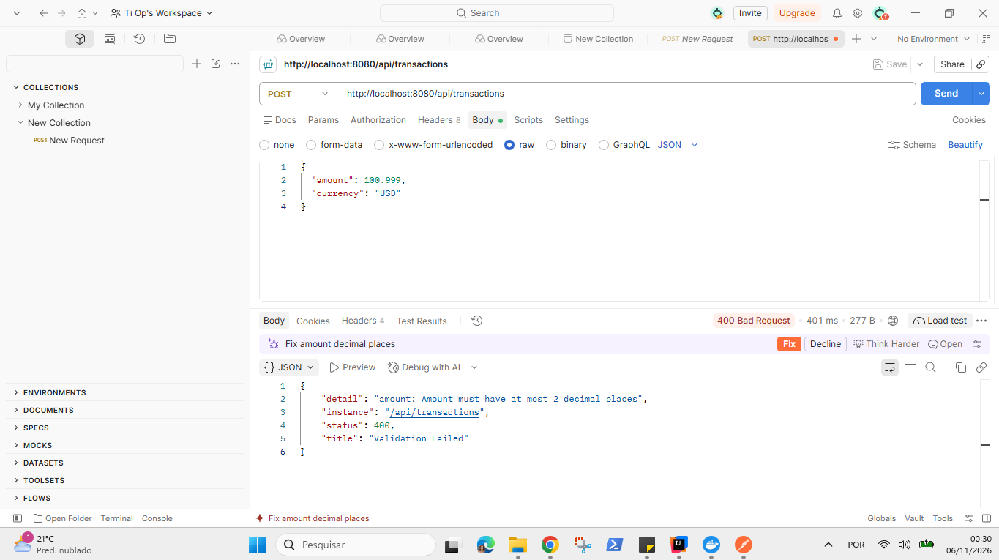

**Currency normalization**

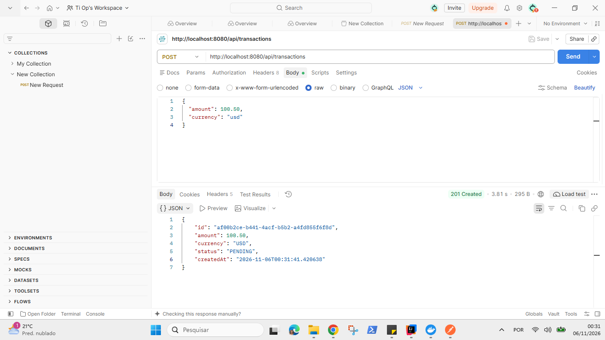

**Transaction listing**

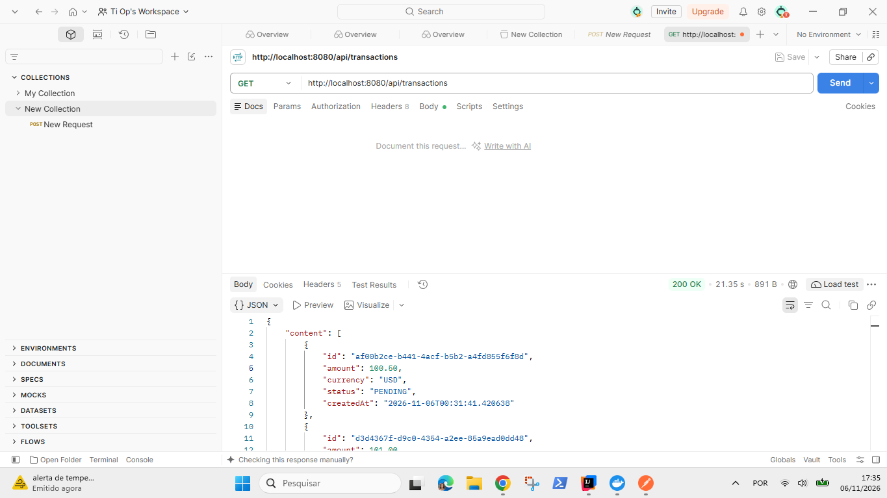

**Status filtering**

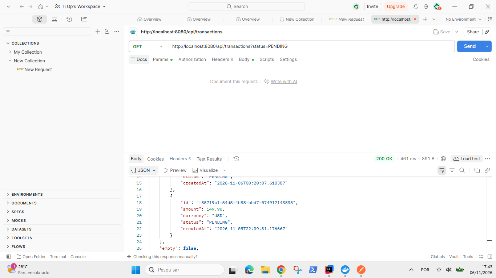

**Pagination**

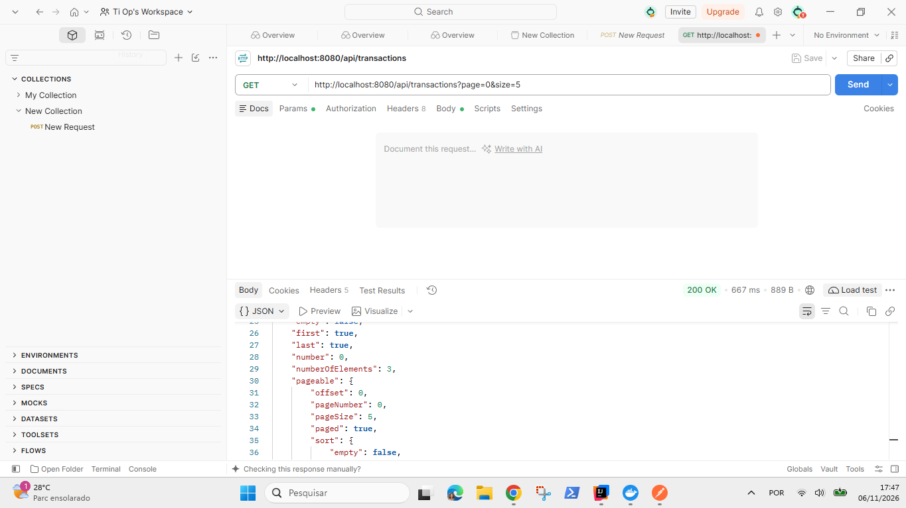

**Sorting**

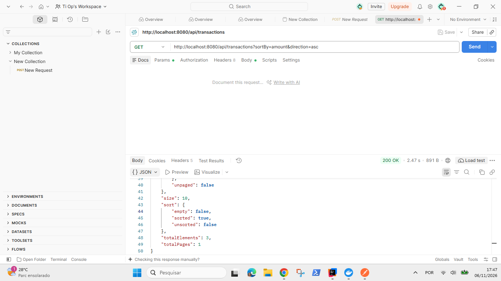

### 2. Unit Testing

**Transaction service tests**

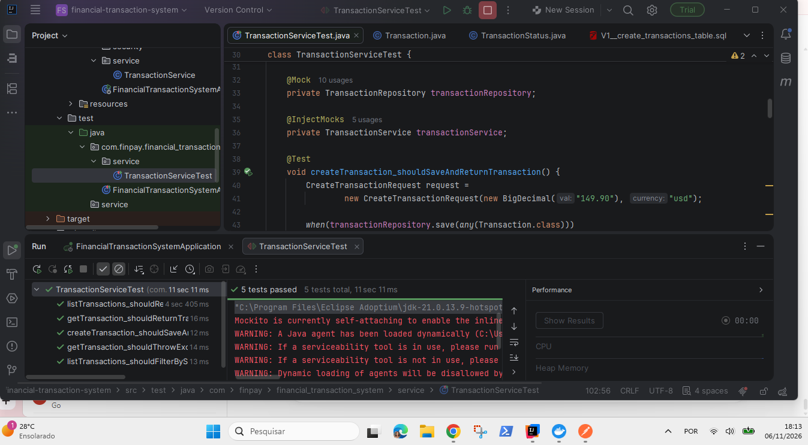

### 3. Stripe Payment Integration

**Successful payment — COMPLETED**

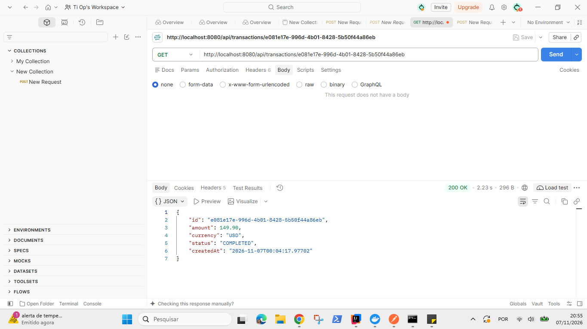

**Failed payment — FAILED**

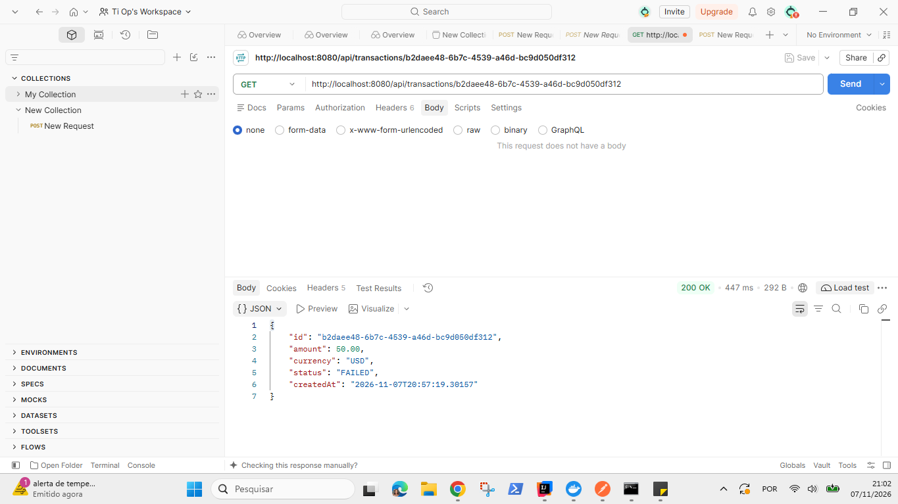

**Webhook environment configuration**

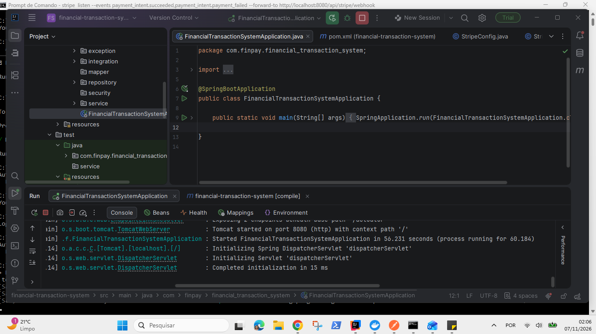

### 4. Security

**HTTP Basic Authentication**

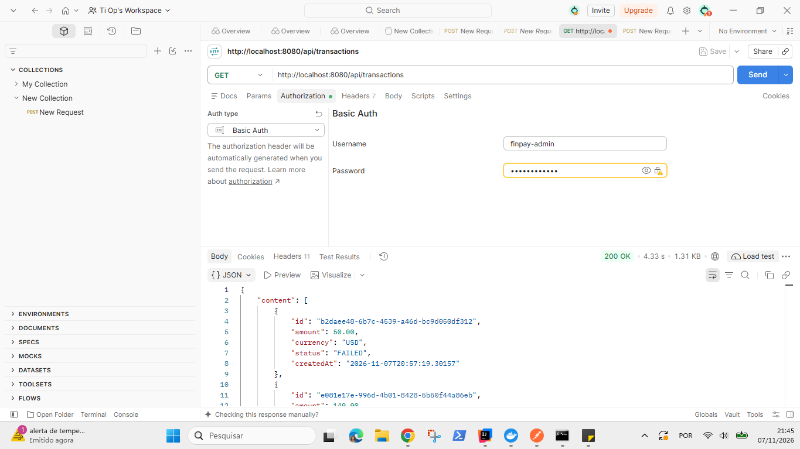

### 5. Docker

**Application health check — UP**

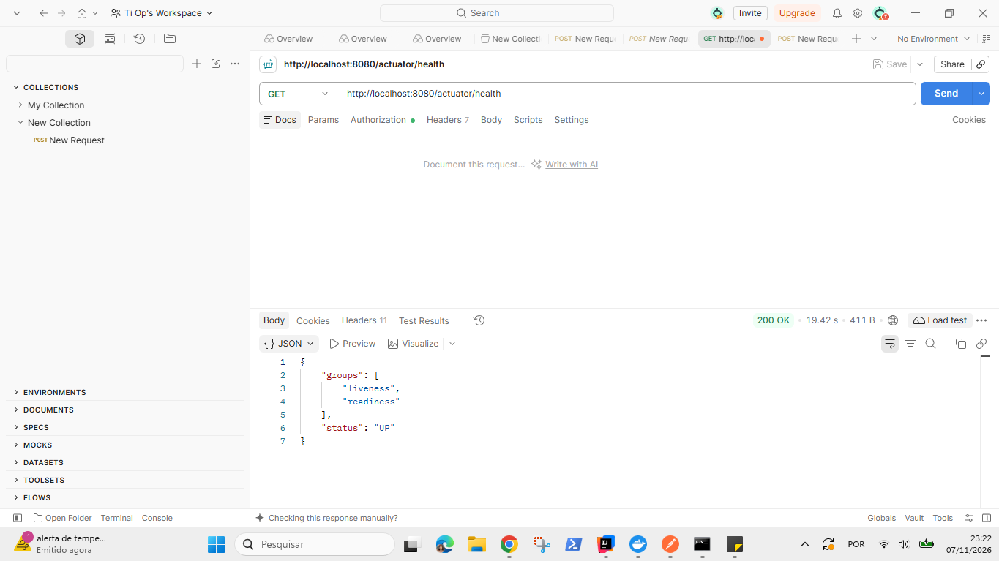
